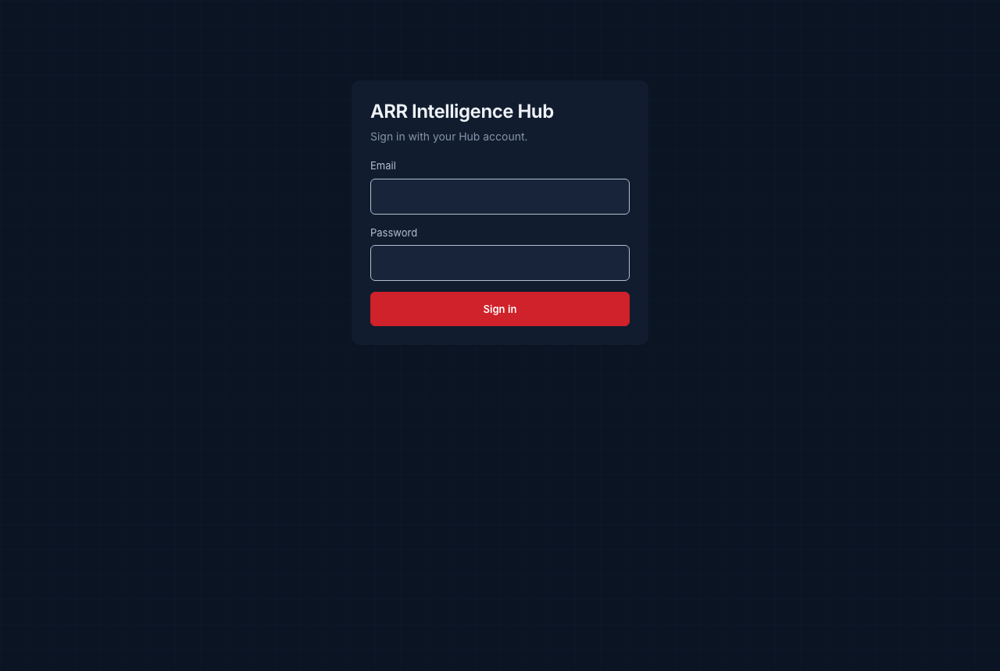
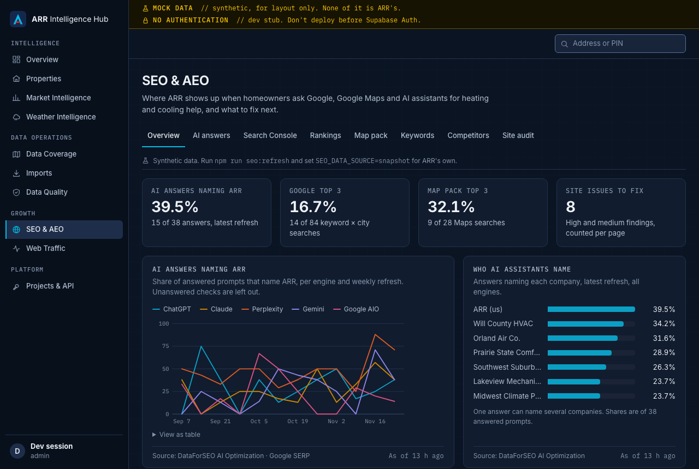
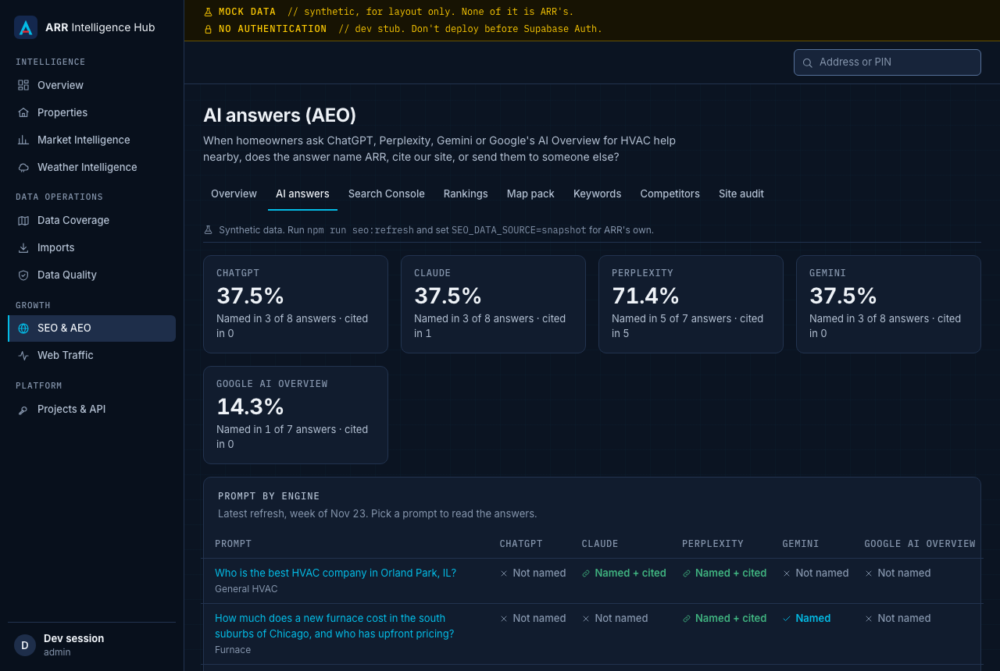
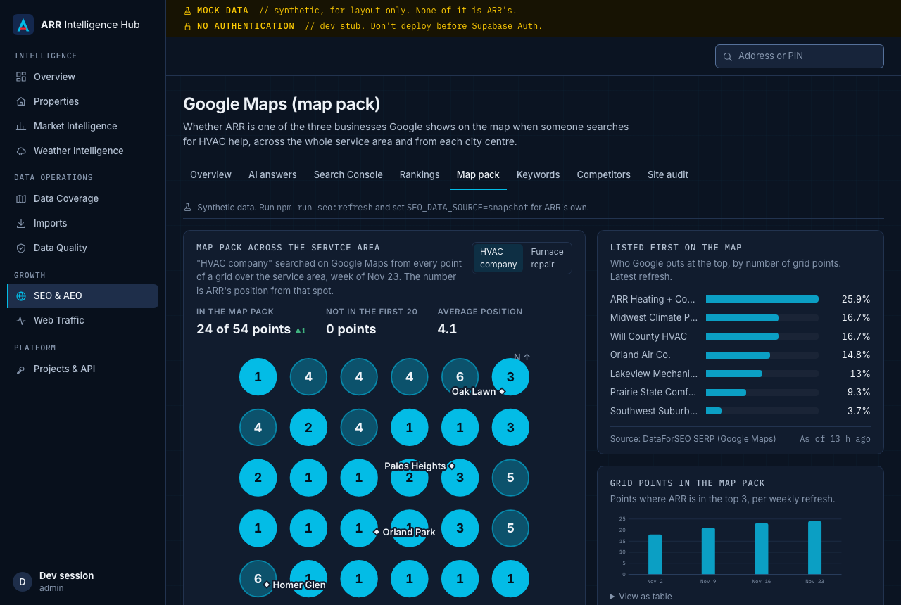
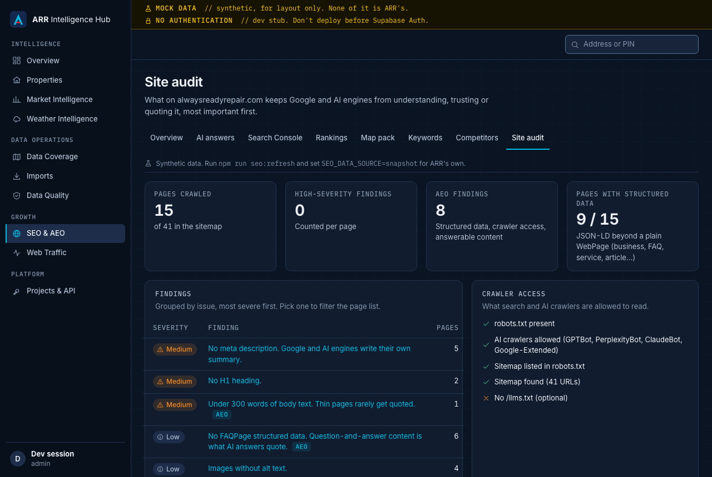
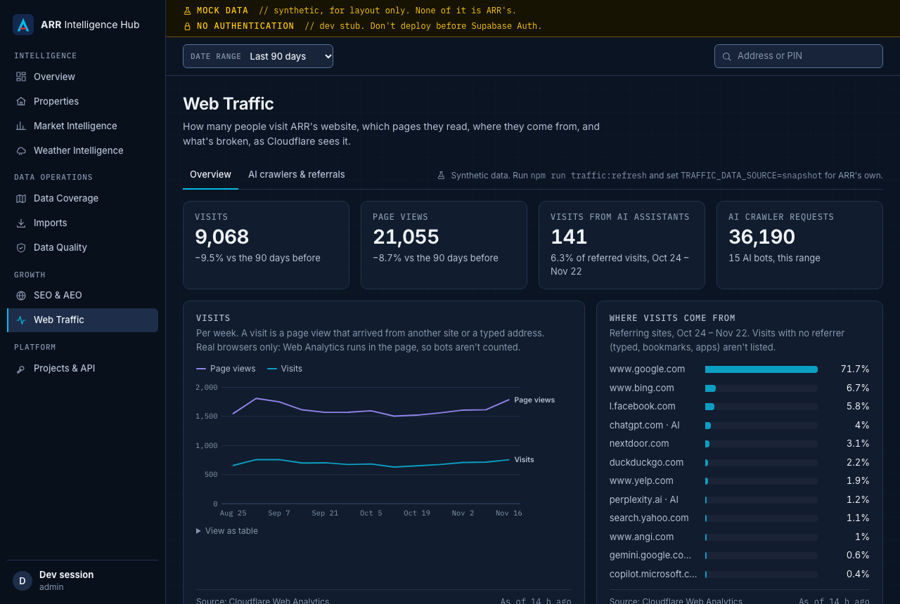

# User guide

Open the Hub's address, sign in with your Hub account, and use the left menu. The Hub is read-only.

| To find out | Open |
|---|---|
| Where ARR shows up overall | SEO & AEO |
| Whether AI assistants name ARR | SEO & AEO, AI answers |
| Our Google position by city and service | Rankings |
| Whether we're in Google's map pack | Map pack |
| What people search for | Keywords |
| Who outranks us | Competitors |
| What to fix on the website | Site audit |
| Clicks Google measured | Search Console |
| Visits, pages and referrers | Web Traffic |
| Which AI crawlers read our site | Web Traffic, AI crawlers |

Reading a panel:
- The footer says where the numbers came from and how old they are. A yellow warning means stale.
- **No data** and **error** are different. An error panel has a retry link.
- Every chart has "View as table".
- Filters are in the address, so you can share a filtered view with another signed-in user.

Sections without real data, such as Properties and Markets, aren't in the menu. If a page says your account has no access, ask a Hub admin for a role.

## Screens

These screenshots show **sample data**, not ARR's numbers, and the development menu. Your menu shows only sections with real data.

**Sign in** 

**SEO & AEO** 

**AI answers** 

**Map pack** 

**Site audit** 

**Web Traffic** 
